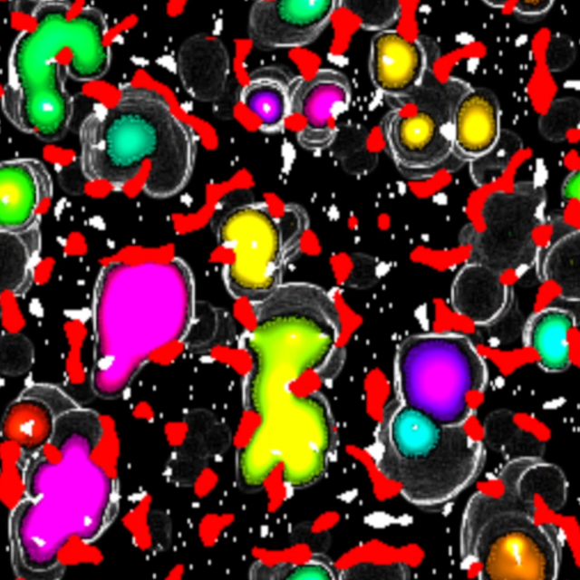
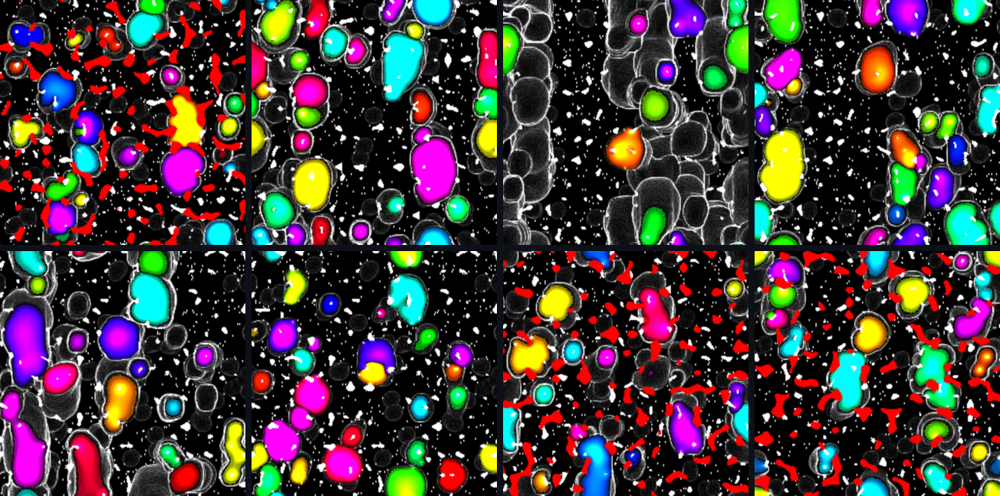
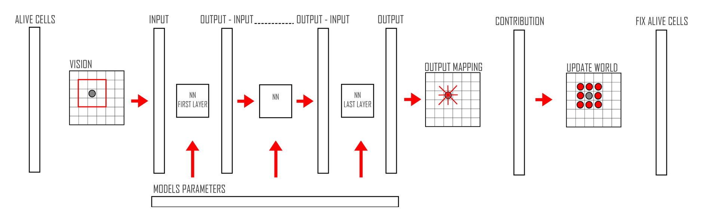
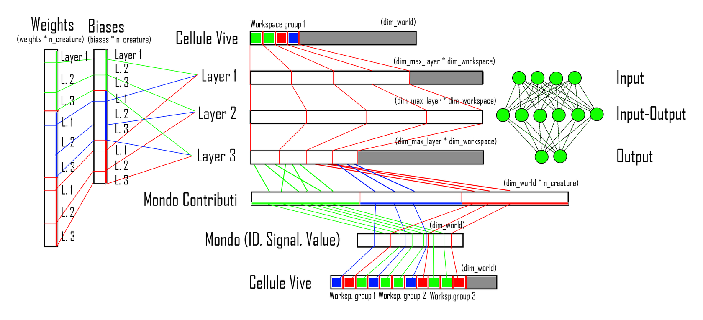

# Cellular Evolution

**GPU-accelerated artificial life inspired by Lenia, where every creature is a neural network trained with Evolution Strategies. Written in CUDA.**

  
   
  Red: obstacles · White: food · Colors: individual creatures

## Overview

Cellular Evolution starts from the same question as [Lenia](https://chakazul.github.io/lenia.html): can we find a stable "cell" able to survive in a world with given characteristics? Instead of searching for hand-tuned update rules, we approach it from a **machine learning** angle.

Each creature begins as a single atomic cell equipped with its own intelligence: a **deep neural network** that decides, cell by cell, how to move energy and what signal to emit. Depending on the task, the goal is to **expand, gather as much energy as possible, or occupy as much space as possible**.

Training uses **Evolution Strategies (ES)** with a twist. Standard ES evaluates each perturbed copy of the model in its own environment. Here, **all perturbed variants share the same world**, so they must adapt not only to the environment but also to each other. Success depends on outperforming the competition, which leads to emergent competitive behavior.

### Highlights

- Lenia-inspired cellular world with food, obstacles, aging and combat
- One neural network per creature, evaluated in parallel for every living cell
- Evolution Strategies with all population members competing in a shared environment
- Fully on GPU: world generation, NN inference, world update, scoring and model update
- Batched NN evaluation over memory-aware "workspace" groups
- Real-time OpenGL visualization
- Tested on an **NVIDIA GeForce 930MX** and an **NVIDIA RTX A5500**

  

## How it works

### The world

The world is a `W × W` grid. Every cell stores:

| Field  | Meaning |
|--------|---------|
| **ID** | Owner of the cell: `-1` obstacle, `0` free/neutral, `1..N` creature ID |
| **Value** | Energy of the occupying creature, or the amount of food if the cell is empty |
| **Signal** | Communication channel between cells |

To make decisions, a living cell only sees a **local neighborhood** of energy and signal values.

### Rules

Some rules are fixed, others are controlled by hyperparameters.

- **Aging and energy decay.** Every step a fixed amount of energy is subtracted from each cell. Below a threshold the cell dies, its ID resets to `0`, and its leftover energy stays on the map as food.
- **Food.** Food is placed both in clusters (Perlin noise) and randomly. Cells near food can consume it to gain energy. When a food cell is attacked, it spreads its energy to the surrounding cells.
- **Obstacles.** Static regions whose value never changes during an epoch. Creatures cannot interact with them, and any energy sent onto an obstacle is lost.
- **Combat.** Creatures attack each other with the same mechanism used to consume food. Two formulas resolve contests: one for empty cells receiving energy from several sources, one for occupied cells being attacked by other creatures.

### Epochs and steps

- An **epoch** generates a new random world (from hyperparameters such as food and obstacle distribution) and a new population of `N` creatures.
- Each epoch runs `n` **steps**, in which every living cell decides how to act. The epoch also ends early if all cells die.
- During the epoch, cumulative **energy** and **occupation** scores are tracked for every creature.

### Training: Evolution Strategies

At the end of each epoch the base model is updated from the scores of its perturbed variants:

$$
\theta_{t+1} = \theta_t + \alpha \frac{1}{n\sigma} \sum_{i=1}^{n} R_i \, \epsilon_i
$$

| Symbol | Meaning |
|--------|---------|
| $\alpha$ | Learning rate |
| $\sigma$ | Standard deviation of the Gaussian perturbation |
| $n$ | Population size |
| $\theta_t$ | Policy parameters at iteration $t$ ($\theta_0$ is the initial vector) |
| $\epsilon_i$ | Gaussian noise sampled for individual $i$ |
| $R_i$ | Fitness of the perturbed policy $\theta_t + \sigma\epsilon_i$ |

## Program pipeline

1. **Info and allocation.** Unpacks simulation data, queries the GPU, allocates all memory, and loads the model (or creates it if none exists).
2. **Epoch preparation.** Generates the world and the creature variants for the current epoch.
3. **Step.** Computes the actions of every living cell, updates the world from the creatures' contributions, updates scores, and rebuilds the list of living cells.
4. **Recombination.** Updates the base model with the ES formula above.
5. **Cleanup.** Frees all CPU and GPU resources after the last epoch.

### Simulation cycle

  

For each step: living cells **look** at their neighborhood, the inputs flow through the **network layers**, the outputs are **mapped** to energy contributions on the surrounding cells, the **world is updated**, and the list of **living cells is rebuilt**.

### Memory layout and workspaces

  

GPU memory holds:

- **World state:** energy values, IDs, signals and per-creature contributions, plus an RGB buffer for rendering
- **Living cells:** a compact index list, so only active cells are processed
- **Models:** the base model plus the weights, biases and perturbations of every variant in the current epoch
- **Scores:** accumulated energy and occupation per creature
- **Workspaces:** the most performance-critical buffers, used for all per-cell NN computations

Each workspace needs two float arrays (input and output) as large as the widest layer of the network. Workspaces are grouped according to the available VRAM, and the living-cells array is partitioned across these groups. This maximizes parallelism while staying within the hardware's memory limits.

## CUDA kernels

| Kernel | Purpose |
|--------|---------|
| Init curandState | Initializes 1024 `curandState`s (the maximum threads per block) |
| Fill random | Fills a device vector range with random values between a min and a max, reusing the precomputed `curandState`s |
| Perlin noise (food / obstacles) | Generates food and obstacle clusters. Size and density are controlled by scale, threshold and offset. The permutation table lives in **constant memory** |
| Add object to world | Scatters food or obstacles on random free cells, with random values in a given range |
| Generate clone creature | Creates the population: the first creatures are perturbations of the base model, the rest are fully random. Weights, biases and their variations are stored in contiguous vectors |
| `Vision_kernel` | Builds each cell's input from its neighborhood: obstacles contribute negative values, cells contribute their energy, ally signals stay positive and enemy signals are inverted |
| `NN_forward_weights_and_biases` | Runs the network layer by layer. Every cell of the workspace group is evaluated simultaneously, with output copied back to input between layers |
| `Output_elaboration` | Reads the first `N×N` outputs as the energy distributed to the neighborhood and the last one as the new signal. Energy goes into `world_contribution` (`W × W × N`), offset by creature ID |
| World update | One thread per pixel: separates ally and enemy energy against the cell's original ID and resolves its next state |
| Compact with Thrust | Rebuilds a dense list of living-cell indices using Thrust stream compaction |
| Color map | Fills the RGB buffer for OpenGL: creature ID → hue, energy → brightness |
| Compute energy and occupation | Accumulates per-creature scores with a **shared-memory reduction** to avoid `atomicAdd` contention |
| `Update_model` | Applies the ES update. Launched with one block per parameter and one thread per creature, so no race conditions. Total score and per-creature contributions are kept in shared memory for normalization and standard deviation |

## Performance iterations

Kernel configurations were benchmarked with **Nsight Systems** (`nsys profile`). The reports for the final versions are included in the repository.

**v1: Streams for allocation.** Allocation, setup and deallocation were parallelized with streams. This only fully worked on the A5500 (compute capability > 5); the 930MX only supported asynchronous memcpy. The gain was real but largely cancelled out by synchronization waits.

**v2: One stream per workspace.** `vision_kernel`, `NN_forward` and `world_update` processed a single workspace per call, with one stream per workspace to compute creatures in parallel. The code was cleaner, but on the A5500 the CPU could not launch kernels fast enough: at most two streams ever overlapped, and a required `cudaDeviceSynchronize` at the end of each workspace block added further stalls.

**v3: Batched, single stream (current).** The same kernels now process all workspaces in batch on the default stream. No device-wide synchronization is needed, and the kernel-launch bottleneck disappears.

## Limitations and future work

- **World size.** Very large worlds do not fit in memory. A possible fix is tiling: process the world in chunks with padding at the borders, then merge the results.
- **Number of creatures.** The contribution buffer scales with `world size × creatures`. Packing contributions into 4- or 8-byte encodings (for example, a fixed range per creature) would cut memory usage, at the cost of capping the energy a cell can hold.
- **Living-cells compaction.** As the population grows, Thrust compaction and its synchronizations dominate the runtime. Launching threads over the whole grid and exiting early on dead cells is faster and more stable for large simulations, but adds overhead on small worlds or sparse populations.

## Data structures

<b>Dimensions</b>

| Name | Symbol | Description |
|------|--------|-------------|
| `world_dim` | W | Side length of the world |
| `n_creature` | N | Number of creatures in the simulation |
| `n_layer` | L | Number of layers in the model |
| `n_weight` | NW | Total number of weights in a model |
| `n_bias` | NB | Total number of biases in a model |

<b>Host variables</b>

| Variable | Shape | Description |
|----------|-------|-------------|
| `world_value_h` | (W, W) | Value of each cell |
| `world_id_h` | (W, W) | ID of each cell (`-1` obstacle, `0` neutral, `1..N` creature) |
| `world_signal_h` | (W, W) | Signal of each cell |
| `world_rgb_h` | (W, W, 3) | RGB map for rendering, built from values or signals and IDs |
| `energy_vector_h` | (N) | Energy score per creature |
| `occupation_vector_h` | (N) | Occupation score per creature |
| `alive_cells_h` | (W, W) | Living cells |
| `n_cell_alive_h` | 1 | Number of living cells |
| `model_weights_h` | (NW) | Base model weights |
| `model_biases_h` | (NB) | Base model biases |

<b>Device variables</b>

| Variable | Shape | Description |
|----------|-------|-------------|
| `world_value_d` | (W, W) | Device copy of `world_value` |
| `world_id_d` | (W, W) | Device copy of `world_id` |
| `world_signal_d` | (W, W) | Device copy of `world_signal` |
| `world_contributions_d` | (W, W, N) | Contribution of each creature to each cell |
| `world_rgb_d` | (W, W, 3) | Device copy of `world_rgb` |
| `energy_vector_d` | (N) | Device copy of `energy_vector` |
| `occupation_vector_d` | (N) | Device copy of `occupation_vector` |
| `model_weights_d` | (NW) | Device copy of `model_weights` |
| `model_biases_d` | (NB) | Device copy of `model_biases` |
| `new_models_weights_d` | (NW, N) | Weights of all generated models |
| `new_models_biases_d` | (NB, N) | Biases of all generated models |
| `variation_weights_d` | (NW, N) | Weight perturbations relative to the base model |
| `variation_biases_d` | (NB, N) | Bias perturbations relative to the base model |
| `alive_cells_d` | (W, W) | Device copy of `alive_cells` |
| `n_cell_alive_d` | 1 | Device copy of `n_cell_alive` |
| `curandStates` | 1024 | cuRAND generator states (one per thread of a full block) |
| `workspace_input_d` | max(layer dims) | Input buffer for NN layer computation |
| `workspace_output_d` | max(layer dims) | Output buffer for NN layer computation |

## Requirements

- NVIDIA GPU with CUDA support
- CUDA Toolkit (cuRAND and Thrust)
- OpenGL for real-time visualization

## Build and run

<!-- TODO: add build commands, command-line arguments and hyperparameter configuration -->

## Authors

- **Fabio Giorgio Miceli**
- **Adriano Valentini**

## References

- Bert Wang-Chak Chan, [*Lenia: Biology of Artificial Life*](https://arxiv.org/abs/1812.05433), 2019
- Tim Salimans et al., [*Evolution Strategies as a Scalable Alternative to Reinforcement Learning*](https://arxiv.org/abs/1703.03864), 2017
